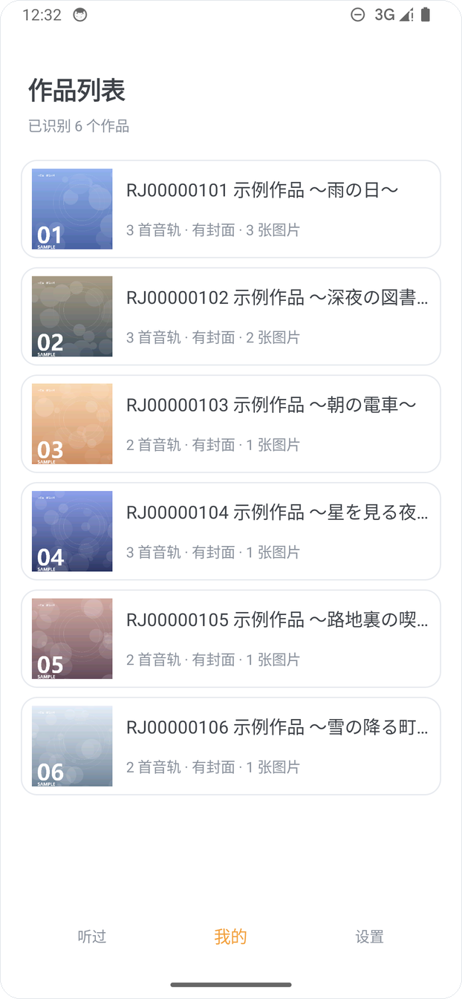
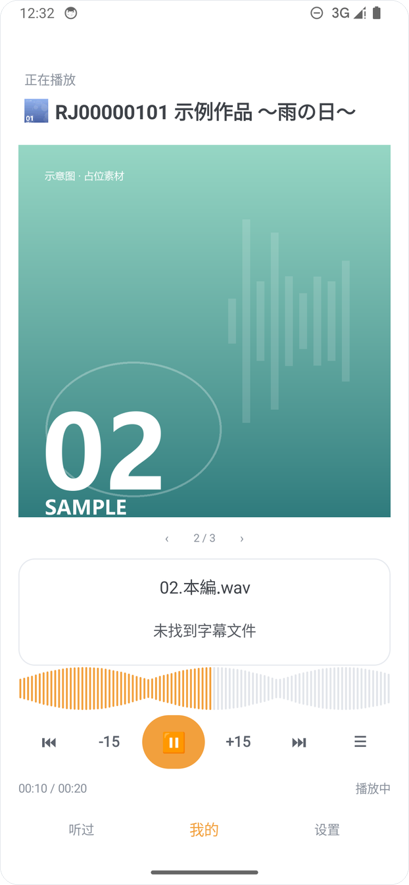
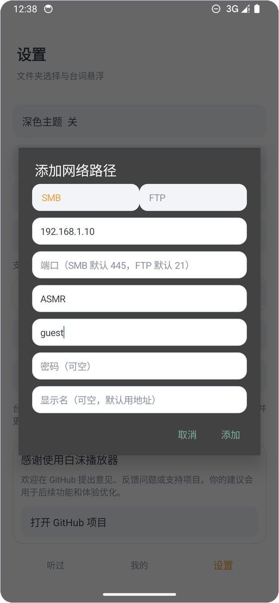
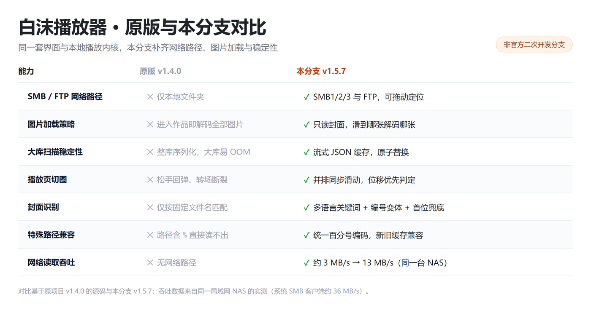
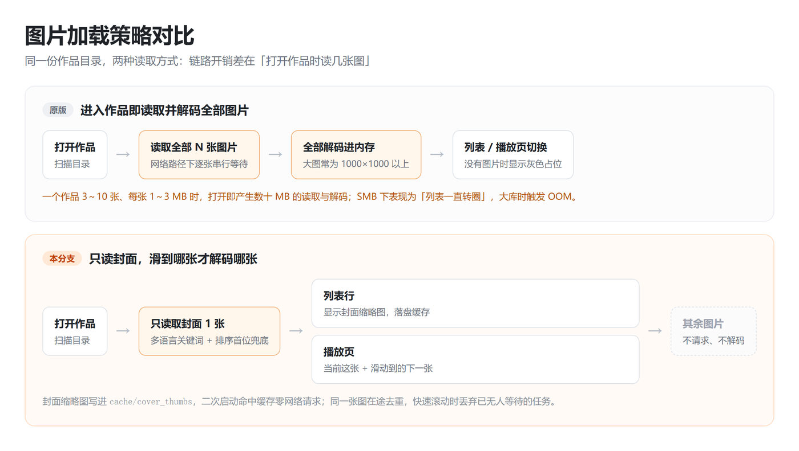

# 白沫播放器 · 二次开发版

> **这是 [Baimo1209/ASMR-Player](https://github.com/Baimo1209/ASMR-Player) 的非官方二次开发分支**，不是原作者发布的版本。
>
> 界面设计、交互与原项目代码版权归原作者 **Baimo（Baimo1209）** 所有。本分支只在其基础上补功能、修问题，保持「纯本地播放器、不附带任何音声资源」的定位。
>
> 如果你是原项目的使用者，建议优先使用[原项目](https://github.com/Baimo1209/ASMR-Player)。本分支的问题请提到本仓库，不要去打扰原作者。

<p align="center">
  
  &nbsp;&nbsp;
  
  &nbsp;&nbsp;
  
</p>

<p align="center">
  <sub>作品列表 · 播放页 · 添加网络路径（截图为自制占位素材，不含任何作品内容）</sub>
</p>

一款安卓 ASMR 音声播放器，安装后显示名为「白沫播放器」。用于管理手机本地或局域网（SMB / FTP）的音频、封面插画与 WebVTT / LRC 同步台词，适合 `RJ01534688/1-普通版/MP3` 这类多层作品目录。

**本仓库只包含播放器源码，不包含任何音频、图片或台词资源。**

## 与原版的区别



| 方向 | 原版 v1.4.0 | 本分支 v1.5.7 |
|---|---|---|
| 网络路径 | 仅本地文件夹 | 新增 SMB（jcifs-ng）与 FTP：连接测试、递归扫描、流式播放、`Range` 拖动定位、远程封面与字幕 |
| 图片加载 | 进入作品即读取并解码全部图片 | 列表只读封面，播放页滑到哪张才解码哪张；封面缩略图落盘缓存 |
| 大库稳定性 | 整库序列化进 SharedPreferences，大库易 OOM | 流式 JSON 缓存（作品级图片池 + 原子替换），后台写入 |
| 排序 | 基础文件名排序 | 统一 `NameOrder`：`track` / `tr` 视为序号整体，全角归一，数字 > 英文 > 中文 |
| 封面判定 | 固定文件名匹配 | 独立 `CoverNames`：`main` / `cover` / `封面` / `表紙` / `ジャケット` 等多语言关键词，支持编号变体，无匹配取排序第一位 |
| 播放页切图 | 松手回弹到反方向、转场断裂 | 新旧两图并排同步滑动，方向由位移决定，支持打断 |
| 特殊路径 | 路径含 `%` 的作品读不出 | 统一 UTF-8 百分号编码，新旧缓存都兼容 |
| 界面 | — | 白色极简主题 + 深色切换、真实波形进度条、设置页可滚动、全屏看图白底 |

### 图片加载策略的差别



一个作品常带 3～10 张 1000px 以上的插画。原版在打开作品时就把它们全部读进内存逐个解码，走 SMB 时表现为「列表一直转圈」，作品多了还会 OOM。本分支只读封面一张，其余按需解码，二次启动命中本地缩略图缓存后几乎零网络请求。

## 主要改动与实测

以下数据来自模拟器 + 局域网 SMB（同一台 NAS，系统 SMB 客户端读数约 36 MB/s）。

**① 网络路径（v1.5.0）**

设置页 →「添加网络路径」填写类型、地址、端口、共享名/目录、账号密码，可先「测试连接」再保存。播放通过本地 `127.0.0.1` HTTP 代理转流，因此支持进度条拖动。

```text
SMB：smb://192.168.1.10/共享名/子目录
FTP：ftp://192.168.1.10:21/子目录
```

**② 图片按需加载（v1.5.3）**

- 列表每行只加载封面，播放页只解码当前张；
- 实测：滚动 8 行从「15 秒后仍是灰色占位」变为 8 秒内 8/8 显示；图片打开次数 16 次/14 唯一（有重复）→ 27 次/27 唯一（零重复）；
- 内存 PSS 从 99.2 MB 降到 62～82 MB。

**③ 读取吞吐（v1.5.5）**

原来每张封面只有约 3 MB/s，瓶颈不是网络：jcifs 的每个 SMB2 READ 请求体取自 `rcv_buf_size`，又被调用方的 16KB 读缓冲截断，等于每 16KB 等一次往返。

- socket 收发缓冲与 `maxRequestSize` 提到 1 MB，读缓冲提到 256 KB；
- 会话单飞建连（首个请求建连、其余复用），首屏前几张不再各等 1 秒；
- 实测同一批封面 32.1 MB：14.25 s / 2.25 MB/s → 4.4 s / 7.3 MB/s；滚动时稳定在 13.65 MB/s。

**④ 切图手感（v1.5.4）**

- 方向判定位移优先：位移超过图宽 9% 就完全由位移决定，不再被松手前的回抖把方向判反；
- 新旧两图同一时长、同一插值器同步位移，间距恒为一张图宽，交接点落在两层显示同一张图的位置；
- 实测连续 8 次左滑 1/13 → 9/13、8 次右滑回到 1/13，16 次严格 ±1，无反向、无断裂。

**⑤ 路径含 `%` 与插画对位（v1.5.6）**

- `net://` URI 里的路径不做编码时，`Uri.getPath()` 会把 `100%毒舌` 的「%毒」当百分号转义解成 NUL 字节（60 → 42 字符），SMB 直接报文件名语法错误。现在统一做 UTF-8 百分号编码，读取走 `getEncodedPath()` 自行解码；
- 插画常被存成 `03.xxx.mp3.png` 而音频是 `03.xxx.mp3`，旧匹配只剥一层扩展名永远对不上，失败后又「保持上一张」，于是点 01 看到 03 的图。现在连续剥掉残留音频扩展名，匹配不到统一回封面；
- 实测该作品 01→07 逐首切：`1/6 → 2/6 → 3/6 → 4/6 → 5/6 → 6/6 → 1/6`，完全对齐。

**⑥ 添加网络路径必定失败（v1.5.7）**

对话框里新建的数据源还没有 `id`，而连接测试开头的会话预热拿 `id` 当缓存键，对 `ConcurrentHashMap` 查 `null` 键直接抛 NPE，路径永远进不了列表。现在测试前就分配 `id`，预热键做了兜底，旧的空 `id` 配置读入时自动补齐；连接与扫描失败的提示也改为显示真实原因。

完整版本差异见 [CHANGELOG.md](CHANGELOG.md)。

## 安装

- 版本：**v1.5.7**（versionCode 12）
- 包名：`com.codex.asmrplayer`
- 系统要求：Android 6.0（API 23）及以上，targetSdk 35
- 下载：本仓库 [Releases](../../releases) 页的 `*-release.apk`

> **与原版不兼容**：包名相同，但本分支使用**自己的签名**，与原版签名不同。因此
> 1. 无法覆盖安装官方版，需先卸载；
> 2. 卸载会清除应用内缓存、排序、SMB/FTP 配置；
> 3. 两者不能共存，如需并存请自行修改 `applicationId` 后重新构建。

## 构建

需要 **JDK 17** 与 Android SDK（compileSdk 35）。先让 Gradle 找到 SDK：

```properties
# local.properties（不要提交）
sdk.dir=C:\\Users\\you\\AppData\\Local\\Android\\Sdk
```

或设置环境变量 `ANDROID_HOME`。

```bash
./gradlew assembleDebug      # 调试包
./gradlew assembleRelease    # 正式签名包（需 keystore.properties + keystore，两者均不入库）
```

Windows 下也可用项目自带脚本，它优先使用仓库内的便携环境（`.gradle-local/`、`.android-sdk/`，均已被忽略），找不到时回退 Wrapper：

```powershell
.\build-apk.ps1            # debug
.\build-apk.ps1 -Release   # release
```

> 首次运行 `gradlew` 会从 `services.gradle.org` 下载 Gradle 8.10.2（约 130 MB）。国内网络较慢时，可把
> `gradle/wrapper/gradle-wrapper.properties` 里的 `distributionUrl` 换成
> `https\://mirrors.cloud.tencent.com/gradle/gradle-8.10.2-bin.zip` 之类的镜像。

`keystore.properties` 格式：

```properties
storeFile=your-release.jks
storePassword=******
keyAlias=your-alias
keyPassword=******
```

缺少该文件时 `assembleRelease` 会直接报错退出，不会生成未签名包。

依赖：`eu.agno3.jcifs:jcifs-ng`、`commons-net:commons-net`、`org.slf4j:slf4j-nop`。

## 网络路径注意事项

- 账号密码以明文 JSON 保存在应用私有 `SharedPreferences`（其他应用读不到，但 root 或备份可获取）。请**不要使用重要的通用密码**，建议为播放器单独建一个只读账号。
- 仅支持 SMB1/2/3（走 jcifs-ng）与 FTP（非 FTPS）。
- 局域网地址请自行确保可信，本应用不校验服务器证书。

## 权限与隐私

| 权限 | 用途 |
|---|---|
| `SYSTEM_ALERT_WINDOW` | 仅「台词悬浮窗」功能使用，不开启则不需要 |
| `INTERNET` / `ACCESS_NETWORK_STATE` | 仅用于你**主动添加**的 SMB/FTP 局域网路径；不访问互联网 |

- 不申请全盘存储权限，只通过系统文件夹选择器读取你授权的目录。
- 不收集、不上传任何文件列表、播放记录、音频、图片或台词；无统计 SDK、无广告。
- 明文 HTTP 仅允许 `127.0.0.1` / `localhost`（供内部转流代理使用）。
- 本地缓存包含作品列表、排序、近期播放记录与网络源配置，已关闭系统自动备份。

## 已知问题

- 大库首次升级到 v1.5.3+ 会重建一次缓存（`library_cache_v4.json`），期间列表稍慢。
- 播放页上返回键无效，只能点底部标签回到列表（原版行为，尚未修改）。
- `%` 路径、插画对位、添加路径失败三个问题已在 v1.5.6 / v1.5.7 修复，如仍遇到请附上 logcat 反馈。

## 鸣谢

- **原作者 [Baimo（Baimo1209）](https://github.com/Baimo1209)** —— 界面、交互、本地播放内核与整个作品目录模型都出自他之手，本分支只是在其 v1.4.0 上继续做延伸。如果这个分支对你有帮助，请先给[原项目](https://github.com/Baimo1209/ASMR-Player)点个 Star。
- 第三方库：[jcifs-ng](https://github.com/AgNO3/jcifs-ng)（LGPL-2.1）、[Apache Commons Net](https://commons.apache.org/proper/commons-net/)（Apache-2.0）、[SLF4J](https://www.slf4j.org/)（MIT）。

## 授权

原仓库未附开源许可证，本分支以 GitHub Fork 形式发布，保留原作者署名与链接。**如原作者对本分支有异议，会立即调整或下线。** 本分支新增代码同样不声明额外许可，默认沿用原项目的授权状态。

## 免责声明

- 本项目仅为播放器工具，不包含、不分发任何音频、图片、字幕资源，也不提供任何内容获取途径。
- 请确保你播放的内容来源合法，并遵守当地法律法规。
- 二次开发分支按「现状」提供，不附带任何明示或暗示的担保；使用风险自负。
